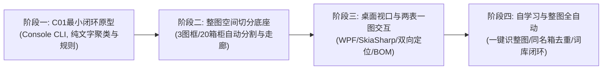

# 10_自主开发分阶段路线与验收标准

**编制时间**：2026-10-16  
**研发路线指导原则**：“极小切口先行、由点及面扩展、持续以真实工程图纸（02-锅炉房-电气921）作为客观验收靶标”。

---

## 一、 四个递进研发阶段规划全景

---

## 二、 分阶段任务明细与定量验收指标

### 阶段一：C01 单柜最小可用原型 (MVP Prototype)
- **研发重点**：不画界面，仅用控制台脚本打通“DWG 图元读取 &rarr; C01 坐标过滤 &rarr; 空间多行文本合并 &rarr; ATS/互感器/浪涌正则匹配 &rarr; 输出 JSON”。
- **唯一测试图纸**：`02-锅炉房-电气921...dwg` 的 C01 区域。
- **定量验收指标**：
  1. 准确输出 C01 柜内 4 组核心元器件（双电源、2 组互感器、浪涌保护器）。
  2. 输出的型号参数与图晓晓实测数据库记录 **100% 一致**。
  3. 执行耗时 **< 1.0 秒**。

### 阶段二：多图框与 20 箱柜空间切分底座 (Spatial Segmentation Core)
- **研发重点**：
  1. 实现基于闭合多段线长宽比的图框自动探测（识别图框一、二、三）。
  2. 实现连续成套柜列（C01~C04）的基准线共享与立柱隔板切分算法。
  3. 实现离散箱体（02AP01, JXX1 等）的独立边框与标题抽取。
  4. 建立垂直引线走廊投影模型。
- **定量验收指标**：
  1. 在《02-锅炉房-电气921》整图模型空间中，自动检出 **3 张图框**，图号图名准确率 **100%**。
  2. 自动切分出全部 **20 台配电箱柜**，柜体空间包围盒检出率 **100%**。

### 阶段三：桌面视口、两表一图联动与 Excel BOM (Desktop & UI)
- **研发重点**：
  1. 基于 .NET 9 WPF + SkiaSharp 实现 CAD 矢量画布，支持 60FPS 极速平移缩放。
  2. 实现左侧箱柜树、中间元器件清单、右侧画布的三框双向高亮定位联动。
  3. 实现行内单元格就地编辑与 `DLQ`/`HGQ` 拼音简写下拉联想。
  4. 实现标准 Excel BOM 工程量清单导出。
- **定量验收指标**：
  1. 打开 10MB 图纸时间 **< 3 秒**。
  2. 单击表格行到画布定位响应时间 **< 100 毫秒**。
  3. 导出的 Excel 格式与工程预算要求完全兼容。

### 阶段四：全图一键识别、同名箱去重与自学习记忆 (Production Release)
- **研发重点**：
  1. 全图一键批量识图调度与后台并发计算。
  2. 同名箱柜跨图纸去重（`SameCab`）与倍数箱工程量乘数折算。
  3. 本地 SQLite 自学习库（自动沉淀用户修改记录并在全图联动改扒）。
- **定量验收指标**：
  1. 全图 20 箱柜、231 个元器件的整图自动化识图耗时 **< 10 秒**。
  2. 综合元器件分类与关键参数准确率 **&ge; 92%**。
  3. 100% 离线运行，零外部网络依赖。
