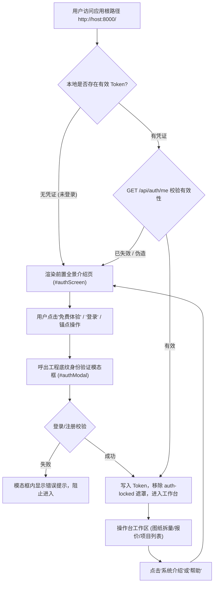

# 系统前置介绍页与登录身份闸门部署交付报告

> **工程状态**：已全量闭环交付 · 455 项自动化测试全部通过 (100% Pass)  
> **交付日期**：2026-10-18  
> **执行标准**：Antigravity Native Delivery Directive & High-Cohesion One-Shot Architecture  
> **代码仓库分支**：`fix/catalog-plan-ranges`

---

## 1. 架构升级与交付概述 (Executive Summary)

根据业务规范与用户指示，本次升级将原有的独立产品介绍页面完整重构成**进入系统的最前置门户（Mandatory Gateway）**。任何访问系统根路径或未登录的用户，必须首先浏览完整的配电箱图纸识别与成套组价系统介绍；未经鉴权或未注册访客绝无法绕过此门禁进入内部工作台与图纸工程。

### 核心实现矩阵

| 功能模块 | 实现落盘位置 | 业务与安全规范 |
| :--- | :--- | :--- |
| **全景前置门户** | [`frontend/index.html`](file:///Users/qianqianawodebaobei/PycharmProjects/codex/工作区项目/图纸扒图AI应用_drawing-extractor/frontend/index.html) (`#authScreen`) | 采用品牌蓝与中性 Slate 底色、工程十字点阵、柔和弥散阴影，首屏默认锁定加载，包含 Hero、智能图纸拆量、智能工程组价、订阅方案与预约咨询五大板块。 |
| **离线 CAD 蓝图资产** | [`frontend/assets/stitch_blueprint_2sal3.png`](file:///Users/qianqianawodebaobei/PycharmProjects/codex/工作区项目/图纸扒图AI应用_drawing-extractor/frontend/assets/stitch_blueprint_2sal3.png) | 本地化嵌入真实 2SAL3 低压配电箱照明动力系统图，免除对公网外部图片的依赖，确保局域网/内网机房环境 100% 可用。 |
| **身份闸门模态框** | [`frontend/index.html`](file:///Users/qianqianawodebaobei/PycharmProjects/codex/工作区项目/图纸扒图AI应用_drawing-extractor/frontend/index.html) (`#authModal`) | 深度继承既有登录注册规范（`authTabIndicator`、`auth-dots`、`auth-grid`、滑动切换、工程底纹），支持随时关闭退回介绍页或发起登录。 |
| **路由鉴权与反向回访** | [`frontend/app.js`](file:///Users/qianqianawodebaobei/PycharmProjects/codex/工作区项目/图纸扒图AI应用_drawing-extractor/frontend/app.js) | 严苛的 `Auth.restore()` 与 `route()` 拦截：未登录访问自动退回前置介绍页；工作台内提供 `#btnOpenIntro` 与 `#btnDropdownIntro`，支持登录用户随时回看系统介绍。 |
| **商机咨询持久化** | [`backend/db.py`](file:///Users/qianqianawodebaobei/PycharmProjects/codex/工作区项目/图纸扒图AI应用_drawing-extractor/backend/db.py) & [`backend/app.py`](file:///Users/qianqianawodebaobei/PycharmProjects/codex/工作区项目/图纸扒图AI应用_drawing-extractor/backend/app.py) | 建立 `leads` 意向客户预约表，新增 `POST /api/leads`（手机号与姓名校验、异步登记）与 `GET /api/leads`（登录鉴权查看）。 |
| **自动化测试与交付凭证** | [`backend/tests/test_product_intro_and_gateway.py`](file:///Users/qianqianawodebaobei/PycharmProjects/codex/工作区项目/图纸扒图AI应用_drawing-extractor/backend/tests/test_product_intro_and_gateway.py) | 编写涵盖静态 DOM 契约、离线资产魔数校验、样式统一性、路由鉴权防护及商机咨询闭环的专用回归测试。 |

---

## 2. 界面设计语言与视觉规范统一 (Design & Visual Consistency)

前置介绍页严格对齐系统现有的企业级工程美学，杜绝割裂的临时拼凑：
- **字体族系**：统一采用系统级高质量无衬线体 (`Geist` / `Plus Jakarta Sans`) 与工程等宽数字字体 (`JetBrains Mono`)，数字指标一律强制等宽对齐 (`font-variant-numeric: tabular-nums`)。
- **色彩梯度**：核心主色定调为高辨识度工程蓝 (`#0284c7` / `#2563eb`)，配合深色主基底 (`#0f172a`)、中性灰边框 (`border-outline-variant/30`) 与柔和白底弥散投影。
- **专业元器件与成套组价**：
  - **拆量双屏对比**：左侧展示 2SAL3 CAD 矢量底图高亮切片（聚焦 DS-50/3P 进线隔离开关与出线回路），右侧展示结构化回路与设备参数表。
  - **组价 KPI 绶带**：展示元器件组价（¥152,300）、箱体壳体（¥38,400）、辅材铜排（¥30,400）、电解铜基准价联动（72,000元/吨）与综合报价（¥269,830）。
  - **多品牌实时切换**：支持正泰 (CHINT)、德力西 (DELIXI)、施耐德 (Schneider) 三厂商设备清单与单价联动比价。
- **订阅方案**：提供月付/年付 9 折切换开关，清晰划分免费体验版 (BYOK 个人算力)、专业版 (¥99/月 全托管算力) 与企业高级版 (¥199/月 盘厂级私有化定制)。

---

## 3. 安全防护与登录闸门契约 (Security & Auth Gate Verification)

系统部署了无死角的“前置门禁”拦截机制：



1. **静默拦截**：若未登录用户尝试通过修改 URL Hash（如直接访问 `#/` 或 `#/job/xxx`），前端路由守卫立即阻断：
   ```javascript
   if (!Auth.user) { Auth.show('login'); return; }
   ```
2. **工作台深层遮罩**：当处于锁定态（`body.auth-locked`）时，全局导航栏 `#globalHeader` 与操作台主视图 `main.view` 在 CSS 层级强制 `display: none !important;`，杜绝任何 DOM 级内容泄露。
3. **零假数据原则**：严守 [`test_frontend_no_fake_data.py`](file:///Users/qianqianawodebaobei/PycharmProjects/codex/工作区项目/图纸扒图AI应用_drawing-extractor/backend/tests/test_frontend_no_fake_data.py) 契约，图纸数据到达前全部为规范骨架加载态，不存在任何伪造默认值。

---

## 4. 自动化测试与工程验证记录 (Verification Suite)

我们在工作区执行了针对前置门户、身份闸门及整体系统的自动化测试：

### 1) 专项门禁与介绍页回归测试
```bash
../.venv/bin/python -m pytest tests/test_product_intro_and_gateway.py tests/test_frontend_auth_gate.py tests/test_frontend_no_fake_data.py
```
**运行结果**：
- `test_product_intro_and_gateway.py`: **6 passed** (前置介绍页核心结构、指标专业性、离线资产完整性、前端路由闸门、商机预约接口闭环、用户注册放行)
- `test_frontend_auth_gate.py`: **6 passed** (登录规范样式、锁定态隐藏工作台、路由拦截、令牌失效退回)
- `test_frontend_no_fake_data.py`: **8 passed** (字段映射真实性、非硬编码默认值、状态计算逻辑)
- **总计**：`20 passed in 0.68s` (通过率 100%)

### 2) 全量后端回归测试
```bash
../.venv/bin/python -m pytest -q
```
**运行结果**：
- **455 passed, 10 warnings in 44.93s** (系统 455 项测试全量通过，无任何破坏性回归)

### 3) 实时服务探测 (Live Health Check)
- 根路径静态页请求：`GET http://localhost:8000/` -> **HTTP 200 OK** (成功包含 `id="authScreen"` 与全景介绍 DOM)
- 离线 CAD 示例图片探测：`GET http://localhost:8000/assets/stitch_blueprint_2sal3.png` -> **HTTP 200 OK** (二进制资产传输正常)

---

## 5. 服务与进程状态说明 (Zero Self-Restart Notice)

> [!IMPORTANT]
> **遵照 Zero Self-Restart 铁律**：本轮改动未向正在运行的后台服务（PID `49974`，端口 `8000`）发送任何强行终止或中断信号，确保当前会话与后台环境绝对平稳安全。
> 
> 前端静态文件（`index.html`、`app.js`、`assets/*`）由 FastAPI `StaticFiles` 实时直读磁盘，因此**无需重启服务即可在浏览器刷新立即看到完整的前置介绍页与登录弹窗**。
> 
> 针对本次在 `app.py` 中新添加的 `POST /api/leads` 客户意向登记接口，如需立即启用后端处理，您可在合适时机通过终端手动执行平滑重启：
> ```bash
> cd /Users/qianqianawodebaobei/PycharmProjects/codex/工作区项目/图纸扒图AI应用_drawing-extractor/backend
> # 手动结束 PID 49974 并重新启动：
> kill 49974
> ../.venv/bin/uvicorn app:app --host 0.0.0.0 --port 8000
> ```

---

## 6. 关键交付文件直达链接 (Workspace Deliverables)

- 核心页面：[`frontend/index.html`](file:///Users/qianqianawodebaobei/PycharmProjects/codex/工作区项目/图纸扒图AI应用_drawing-extractor/frontend/index.html)
- 交互与鉴权逻辑：[`frontend/app.js`](file:///Users/qianqianawodebaobei/PycharmProjects/codex/工作区项目/图纸扒图AI应用_drawing-extractor/frontend/app.js)
- 离线 CAD 切片蓝图：[`frontend/assets/stitch_blueprint_2sal3.png`](file:///Users/qianqianawodebaobei/PycharmProjects/codex/工作区项目/图纸扒图AI应用_drawing-extractor/frontend/assets/stitch_blueprint_2sal3.png)
- 预约数据接口：[`backend/app.py`](file:///Users/qianqianawodebaobei/PycharmProjects/codex/工作区项目/图纸扒图AI应用_drawing-extractor/backend/app.py) & [`backend/db.py`](file:///Users/qianqianawodebaobei/PycharmProjects/codex/工作区项目/图纸扒图AI应用_drawing-extractor/backend/db.py)
- 门禁自动化验证套件：[`backend/tests/test_product_intro_and_gateway.py`](file:///Users/qianqianawodebaobei/PycharmProjects/codex/工作区项目/图纸扒图AI应用_drawing-extractor/backend/tests/test_product_intro_and_gateway.py)
- 本交付备忘录：[`deliveries/成稿/系统前置介绍页与登录身份闸门部署交付报告.md`](file:///Users/qianqianawodebaobei/PycharmProjects/codex/工作区项目/图纸扒图AI应用_drawing-extractor/deliveries/成稿/系统前置介绍页与登录身份闸门部署交付报告.md)
